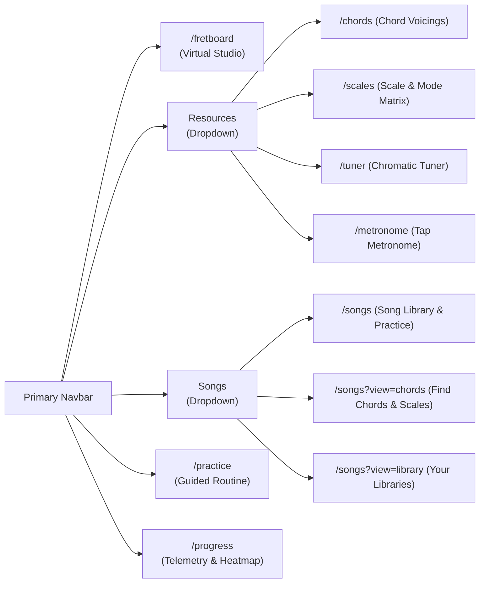

# Fretboard Design System & UI/UX Guidelines

> **The definitive design system, UI/UX architecture, component preferences, and visual tokens for Fretboard.**
> *Last updated to reflect the current Next.js 16 App Router, React 19, Tailwind CSS v4, and Web Audio studio architecture.*

---

## 1. Product Philosophy & Core Identity

Fretboard is an **interactive, local-first guitar studio and music exploration workspace**. It unites fretboard visualization, music theory, song repertoire management, real-time guitar utilities, and guided practice into one tactile musical environment.

### Design Pillars
1. **Editorial Minimalism (Beside-inspired)**: Generous whitespace, calm breathing room, refined typographic hierarchy (Geist + Instrument Serif), and restrained decorative elements.
2. **Precision & Tactility (Linear-inspired)**: Crisp micro-borders, clean tabular alignment, 60fps view transitions, and physical-feeling interactive feedback.
3. **Craftsmanship of the Instrument**: Dark rosewood fretboard surfaces (`#271A19`), metallic nickel-silver frets, ivory bone nut (`#F4EFE6`), wound bronze and silver steel strings, and warm champagne-gold harmonic accents (`#D4AD61`).
4. **Local-First & Zero-Plugin**: Browser `localStorage` (`fretboard:` namespace) with hydration-safe `useSyncExternalStore`. Instant launch, zero account gating, zero proprietary audio plugins.
5. **Zero-Latency Web Audio Synthesis**: Plucked-string physical modeling with 3 distinct guitar tones (Acoustic Steel, Electric Clean, Mellow Nylon) and pure percussive metronome clicks.

---

## 2. Information Architecture & Navigation

The application uses a **5-destination primary navigation structure** with mega-dropdowns for deeper tool suites:

```
Fretboard (Direct) │ Resources (Dropdown) │ Songs (Dropdown) │ Practice (Direct) │ Telemetry (Direct)
```



### Sticky Morphing Navbar Specification (`Navbar.tsx`)
The navbar features a dual-state progressive enhancement:
- **State A (Top of Page / Hero)**: Spacious (`max-w-7xl`, `h-[4.25rem]`, 68px), transparent background, no border, floating seamlessly over the hero and continuous Amber Light Ribbons backdrop.
- **State B (Sticky / Scrolled)**: Morphing into a compact square-rounded capsule (`max-width: min(calc(100% - 2rem), 58.5rem)`, `h-[3.25rem]`, 52px, `rounded-[14px]`, `mt-3`) with frosted backdrop blur (`blur-md`), hairline border, and subtle ambient shadow.
- **CSS-Native Scroll State**:
  ```css
  .navbar-shell {
    position: sticky;
    top: 0;
    z-index: 50;
    width: 100%;
    display: flex;
    justify-content: center;
    pointer-events: none;
    container-type: scroll-state;
    container-name: fretboard-nav;
  }
  @supports (container-type: scroll-state) {
    @container fretboard-nav scroll-state(stuck: top) {
      .navbar-inner {
        max-width: min(calc(100% - 2rem), 58.5rem);
        height: 3.25rem;
        margin-top: 0.75rem;
        border-radius: 14px;
        background-color: var(--nav-stuck-bg);
        border: 1px solid var(--nav-stuck-border);
        box-shadow: var(--nav-stuck-shadow);
      }
    }
  }
  ```
- **Fallback**: High-performance backdrop-filter (`blur(12px)`) with `var(--nav-fallback-bg)` and `var(--nav-fallback-border)`.

### Mega-Dropdown Panels (Desktop)
- **Container**: Floating square-rounded card (`rounded-2xl`, `p-5`, `w-[560px]` for Resources, `w-[640px]` for Songs).
- **Background**: `bg-[#FCFBF9]` (light) / `dark:bg-[#15111B]` (dark) with `border border-[#EAE8E4] dark:border-white/10`.
- **Shadow**: `shadow-[0_24px_64px_rgba(23,23,23,0.15)]` (light) / `dark:shadow-[0_28px_72px_rgba(0,0,0,0.7)]`.
- **Hover Bridge**: A 12px invisible pointer bridge (`-top-3`) ensures smooth mouse transitions without premature menu closing.
- **Motion**: Framer Motion `AnimatePresence` with `y: 8 → 0`, `scale: 0.98 → 1`, `duration: 0.22s`, `ease: [0.22, 1, 0.36, 1]`.

### Mobile & Tablet Navigation Drawer (< 1024px)
- Anchored floating card below the compact header (`px-3 sm:px-6 pt-1 pb-4`).
- Accordion collapsible drawers for **Resources** and **Songs**.
- Direct links with Phosphor icons for **Fretboard**, **Practice**, and **Telemetry**.
- Direct integrated **AuthNav** authentication controls and studio links (permanent Dark Studio theme).

---

## 3. Landing Page Composition & Rhythm

The landing page (`src/app/page.tsx`) features a continuous atmospheric backdrop and 5 editorial sections:

```
┌────────────────────────────────────────────────────────────────────────┐
│ CONTINUOUS AMBER LIGHT RIBBONS LAYER                                   │
│ bg-[url('/images/bg-amber-light-ribbons.svg')] (25% light / 85% dark)  │
├────────────────────────────────────────────────────────────────────────┤
│ 1. Hero Section: Asymmetric 2-Column Composition                       │
│    • Left (col-span-5): Announcement strip, Serif H1, Body, CTAs       │
│    • Right (col-span-7): 4-Card Bento Grid with Cursor Spotlight       │
├────────────────────────────────────────────────────────────────────────┤
│ 2. Feature Showcase (#features): 3-in-1 Unified Tabbed Showcase        │
│    • 01 / Explore (Tunings & fret counts)                              │
│    • 02 / Understand (Scale formulas & interval degrees)               │
│    • 03 / Play (Tone presets & tactile chord pads)                     │
├────────────────────────────────────────────────────────────────────────┤
│ 3. Multiplayer Showcase (#jam): Real-time Jam Room Simulation          │
│    • Room #JAM-8402, 3-avatar stack, live activity feed, Jam Bot       │
├────────────────────────────────────────────────────────────────────────┤
│ 4. Practice Suite Showcase (#tools): 6 Practice Companion Cards        │
│    • Tuner, Metronome, Chords, Scales, Song Vault, Telemetry           │
├────────────────────────────────────────────────────────────────────────┤
│ 5. Final CTA & Footer: Settling Editorial Closing                      │
│    • "Your next note is waiting", primary CTA pill, site sitemap       │
└────────────────────────────────────────────────────────────────────────┘
```

### Hero Section & Bento Grid (`HeroSection.tsx`, `HeroBentoGrid.tsx`)
- **Left Column (`lg:col-span-5`)**:
  - Announcement bar with pulse dot: `Zero-Plugin Web Audio • Instant Local Access`.
  - Editorial headline: `Explore the fretboard. ` + `<span className="font-serif italic">Find your sound.</span>`.
  - Primary pill button: `Start playing →` (routes to `/fretboard`).
  - Secondary ghost button: `Explore features` (smooth scrolls to `#features`).
- **Right Column (`lg:col-span-7`)**: Asymmetric 2-subcolumn Bento Grid with scroll parallax:
  - **Card 1 (`01 • Anatomy`)**: Living fretboard neck slice with 6 physical strings, bone nut, and plucking audio.
  - **Card 2 (`02 • Theory & Scales`)**: Dynamic root key selector (A, C, G, E) with harmonic interval formula tags.
  - **Card 3 (`03 • Tone Studio`)**: 3 tone preset selector pills (Acoustic Steel, Electric Clean, Mellow Nylon) with animated audio visualizer bars.
  - **Card 4 (`04 • Multiplayer Jam Rooms`)**: `#JAM-8402` live pulse tag, 3-avatar stack (`YO`, `AL`, `SR`), and Jam Bot toggle.
- **Velocity-Driven Parallax**: Smooth `useSpring` displacement (`yCol1: [35, -30]`, `yCol2: [70, -45]`).
- **Dynamic Cursor Spotlight**:
  ```css
  background: radial-gradient(320px circle at ${x}px ${y}px, rgba(212, 173, 97, 0.10), rgba(245, 158, 11, 0.05), transparent 70%);
  ```

---

## 4. Virtual Fretboard Studio Anatomy (`/fretboard`)

The Virtual Fretboard Studio is the primary interactive instrument workspace, rendered via `GuitarPreview.tsx` and `LivingFretboard2D.tsx`.

### Physical Layout & Dimensions
- **Bound Rosewood Neck (`.fretboard-wood`)**:
  - Base color: `#271A19` (rich Brazilian rosewood).
  - Subtle wood grain texture via dual CSS gradients:
    ```css
    .fretboard-wood {
      background-color: #271A19;
      background-image: 
        linear-gradient(90deg, rgba(56, 33, 31, 0.8) 0%, rgba(39, 26, 25, 0.98) 50%, rgba(56, 33, 31, 0.8) 100%),
        repeating-linear-gradient(0deg, transparent, transparent 3px, rgba(0, 0, 0, 0.15) 3px, rgba(0, 0, 0, 0.15) 6px);
    }
    ```
  - Ivory edge binding (`#E8DFD3` top and bottom) replicating physical bound guitar necks.
- **Equal-Tempered Fret Spacing**:
  - Frets narrow mathematically toward the body using the 12th root of 2 formula ($w_n \propto 2^{-(n-1)/12}$).
  - Nickel-silver metal fret wires: `1.5px` silver dividers with highlight/shadow beveling.
- **Bone Nut (Fret 0)**:
  - Distinct ivory-cream slab (`#F4EFE6`) positioned on the left with dedicated open-string plucking nodes.
- **Pearloid Inlays**:
  - Single circular pearlescent dot markers at frets **3, 5, 7, 9, 15, 17, 19, 21**.
  - Double circular pearlescent dot markers at frets **12** and **24** (the octave registers).
- **6 Physical Strings**:
  - Strings 1–3 (Treble: E4, B3, G3): Plain silver steel (`#F0F4F8` / `#C4CCD6`, 1.0px–1.7px gauge).
  - Strings 4–6 (Bass: D3, A2, E2): Wound bronze (`#E2B565` / `#B8852B`, 2.2px–3.5px gauge) with wound texture striping.
  - Realistic string vibration animations on pluck (`animate-string-pluck-bass`, `animate-string-pluck-mid`, `animate-string-pluck-treble`).

### Studio Toolbar & Configuration Controls
- **Tuning Selector**:
  - Standard (`E A D G B E`)
  - Drop D (`D A D G B E`)
  - DADGAD (`D A D G A D` - Celtic / Folk)
  - Open D (`D A D F# A D`)
- **Fret Count Options**: `12F` (Compact), `15F` (Default), `21F` (Vintage), `24F` (Extended Soloist).
- **Root Key**: 12 chromatic root keys (C through B).
- **Scale Engine**: 8 scales/modes (Minor Pentatonic, Major Pentatonic, Blues, Major/Ionian, Natural Minor/Aeolian, Dorian, Mixolydian, Free Play).
- **Display Modes**:
  - `notes`: Shows note names (C, D, E, F#, etc.).
  - `intervals`: Shows harmonic intervals relative to root (`R`, `♭3`, `4`, `5`, `♭7`).
  - `clean`: Minimalist pearloid node markers without text clutter.

---

## 5. Design Tokens

### 5.1 Color Palette

| Token Name | Hex / Value | Semantic Role |
| :--- | :--- | :--- |
| **`--bg-light`** | `#FCFBF9` | Warm ivory primary canvas (light mode) |
| **`--bg-dark`** | `#0C0A09` | Deep rosewood-tinted stone (dark mode) |
| **`--bg-dark-ambient`** | `#0E0B14` | Deep violet-black for continuous ambient hero layers |
| **`--text-primary-light`** | `#171717` | High-contrast charcoal text |
| **`--text-primary-dark`** | `#F5F5F4` | Crisp off-white text |
| **`--text-secondary-light`**| `#77746F` | Soft reading text |
| **`--text-secondary-dark`** | `#A8A29E` | Muted neutral text |
| **`--accent-gold`** | `#D4AD61` | Primary harmonic gold: root notes, active states, key glyphs, cursor spotlight |
| **`--accent-gold-soft`** | `#E9D8B7` | Champagne gold hover tints, text selection background |
| **`--accent-amber`** | `#E2B565` / `#F59E0B` | Amber Light Ribbons ambient glow & spotlight highlights |
| **`--accent-bronze`** | `#B8852B` | Wound bass strings & deep warm gold resonance |
| **`--fretboard-wood`** | `#271A19` | Dark Brazilian rosewood fretboard neck |
| **`--fretboard-nut`** | `#F4EFE6` | Polished bone nut (Fret 0) |
| **`--border-light`** | `#EAE8E4` | Hairline off-white border |
| **`--border-dark`** | `rgba(255, 255, 255, 0.1)` | Subtle hairline dark mode border |

### 5.2 Typography Stack
- **`font-sans` (Geist Sans)**: Primary interface typography, controls, body copy, and labels.
- **`font-serif` (Instrument Serif, Normal & Italic)**: Display headlines, section headers, and brand accents (`font-serif italic`).
- **`font-mono` (Geist Mono with `font-variant-numeric: tabular-nums`)**: Tabular figures, BPM readouts, chord tab strings (`x-3-2-0-1-0`), frequencies, and interval badges.

#### Typographic Scale

| Level | Size & Weight | Classes | Usage |
| :--- | :--- | :--- | :--- |
| **Hero H1** | 56–64px / 400 | `text-4xl sm:text-5xl lg:text-6xl font-normal tracking-[-0.035em] leading-[1.08] text-balance` | Landing hero title |
| **Section H2** | 36–48px / 400 | `text-3xl sm:text-4xl lg:text-5xl font-normal tracking-[-0.03em] leading-[1.15] text-balance` | Section headers with `font-serif italic` |
| **Card H3** | 20–24px / 600 | `text-xl sm:text-2xl font-semibold tracking-tight text-[#171717] dark:text-[#F5F5F4]` | Showcase titles, tool headers |
| **Body (Lead)** | 16–18px / 400 | `text-base sm:text-lg text-[#77746F] dark:text-[#A8A29E] leading-[1.65]` | Section descriptions |
| **Body (Standard)**| 13–14px / 400 | `text-xs sm:text-sm text-[#77746F] dark:text-[#A8A29E] leading-relaxed` | Tool descriptions, card body |
| **Eyebrow** | 11px / 500 / Mono | `text-[11px] font-mono font-medium tracking-[0.16em] uppercase text-[#77746F] dark:text-[#A8A29E]` | Section badges, metadata tags |
| **Technical Data** | 10–12px / 600 / Mono | `text-xs font-mono font-semibold tracking-tight tabular-nums` | Chords, tabs, BPM, cents, Hertz |

### 5.3 Corner Radii Hierarchy
- **Outer Showcase Cards & Modals**: `rounded-3xl` (24px)
- **Secondary Containers & Neck Enclosures**: `rounded-2xl` (16px)
- **Control Groups, Chord Pads & Micro-cards**: `rounded-xl` (12px)
- **Buttons, Eyebrow Pills, Nut Nodes & Inlays**: `rounded-full` (9999px)

### 5.4 Elevation & Surface Shadows
- **Light Neutral Shadow**: `shadow-[0_20px_50px_rgba(23,23,23,0.04),0_1px_3px_rgba(0,0,0,0.02)]`
- **Dark Ambient Shadow**: `dark:shadow-[0_25px_60px_rgba(0,0,0,0.35)]`
- **Active Pluck Glow**: `shadow-[0_0_15px_rgba(212,173,97,0.95)]`
- **Root Note Glow**: `shadow-[0_0_6px_rgba(212,173,97,0.4)]`

---

## 6. Component Patterns & Visual Styling

### 6.1 Buttons & Interactive Controls

#### Primary Pill Button ("Start playing →")
```tsx
<button
  type="button"
  onClick={onStartPlaying}
  className="group inline-flex items-center gap-2.5 px-6 py-3.5 sm:px-8 sm:py-4 rounded-full bg-[#171717] dark:bg-[#F5F5F4] hover:bg-[#2b2b2b] dark:hover:bg-white text-white dark:text-[#171717] text-sm font-semibold tracking-tight transition-all duration-200 shadow-[0_4px_14px_rgba(23,23,23,0.12)] hover:shadow-[0_6px_20px_rgba(23,23,23,0.18)] active:scale-[0.98] cursor-pointer"
>
  <span>Start playing</span>
  <span className="transition-transform duration-200 group-hover:translate-x-1">→</span>
</button>
```

#### Secondary Ghost Pill Button
```tsx
<button
  type="button"
  className="inline-flex items-center px-4 py-3.5 rounded-full text-sm font-medium text-[#77746F] dark:text-[#A8A29E] hover:text-[#171717] dark:hover:text-[#F5F5F4] hover:bg-[#F7F6F3] dark:hover:bg-[#171513] transition-colors duration-200 cursor-pointer"
>
  Explore features
</button>
```

#### Segmented Tab Switcher (01/Explore • 02/Understand • 03/Play)
```tsx
<div className="flex items-center gap-2 bg-[#F1F0ED] dark:bg-[#1A1816] p-1.5 rounded-2xl border border-[#EAE8E4] dark:border-white/10 shadow-xs">
  {tabs.map((tab) => (
    <button
      key={tab.id}
      onClick={() => setActiveTab(tab.id)}
      className="relative px-4 py-2 rounded-xl text-xs font-medium cursor-pointer transition-colors"
    >
      {activeTab === tab.id && (
        <motion.div
          layoutId="activeFeatureTab"
          className="absolute inset-0 bg-white dark:bg-[#282420] rounded-xl shadow-xs border border-black/5 dark:border-white/10"
          transition={{ type: 'spring', stiffness: 380, damping: 30 }}
        />
      )}
      <span className="relative z-10">{tab.label}</span>
    </button>
  ))}
</div>
```

#### Tactile Quick-Strum Chord Pads
Card buttons for strumming chords (`Am`, `C`, `G`, `Em`, `D`, `E`, `A`, `F`) with 35ms staggered pick timing:
- **Rest State**: `bg-[#F7F6F3] dark:bg-[#1C1A17] hover:bg-white dark:hover:bg-[#24201D] border-[#EAE8E4] dark:border-white/10 hover:border-[#D4AD61]/50`
- **Active Strumming State**: `bg-[#E9D8B7]/30 dark:bg-[#D4AD61]/25 border-[#D4AD61] shadow-md ring-2 ring-[#D4AD61]/60 text-[#D4AD61]`

#### Fretboard Note Nodes
- **Open String Nut Button (Fret 0)**: `w-6 h-6 rounded-full flex items-center justify-center text-[10px] font-bold bg-black/25 hover:bg-black/40 text-zinc-300`
- **Scale Note (Resting)**: `w-5 h-5 rounded-full bg-white/85 dark:bg-[#25201C]/90 text-[#171717] dark:text-[#E8E6E3] border border-black/20 dark:border-white/20 text-[9px]`
- **Root Note Highlight (`R`)**: `w-6 h-6 rounded-full bg-[#D4AD61]/35 dark:bg-[#D4AD61]/30 border-2 border-[#D4AD61] text-[#FFEAB3] dark:text-[#F3D799] font-black text-[10px] shadow-[0_0_6px_rgba(212,173,97,0.4)]`
- **Active Plucked Node**: `scale-110 bg-gradient-to-tr from-[#FFE082] via-[#D4AD61] to-[#B8852B] text-zinc-950 font-bold text-[11px] shadow-[0_0_18px_rgba(212,173,97,0.95)] ring-2 ring-white z-40`

---

### 6.2 Badges & Indicator Pills

#### Eyebrow Section Pill Badges
```tsx
<div className="inline-flex items-center gap-2 px-3 py-1 rounded-full bg-[#F7F6F3] dark:bg-[#1A1816] border border-[#EAE8E4] dark:border-white/10 text-[11px] font-mono font-medium text-[#77746F] dark:text-[#A8A29E] mb-4 shadow-xs">
  <span className="w-1.5 h-1.5 rounded-full bg-[#D4AD61]" />
  <span>SECTION 02 • INTERACTIVE STUDIO</span>
</div>
```

#### Harmonic Interval Formula Badges
- **Root Note (`R`)**: `bg-[#D4AD61] text-zinc-950 font-black px-2 py-0.5 rounded-md text-[10px]`
- **Intervals (`♭3`, `4`, `5`, `♭7`)**: `bg-white/90 dark:bg-zinc-800 text-[#171717] dark:text-[#F5F5F4] border border-black/10 dark:border-white/10 px-1.5 py-0.5 rounded text-[10px]`

#### Live Equalizer Status Badge
```tsx
<span className="flex items-end gap-0.5 h-3 w-3">
  <span className="w-0.5 bg-[#D4AD61] rounded-full h-3 animate-pulse" />
  <span className="w-0.5 bg-[#D4AD61] rounded-full h-2 animate-pulse [animation-delay:0.15s]" />
  <span className="w-0.5 bg-[#D4AD61] rounded-full h-2.5 animate-pulse [animation-delay:0.3s]" />
</span>
```

---

## 7. Integrated Practice Companion Suite

Each tool is built with matching Beside/Linear design system tokens, zero external audio dependencies, and local-first persistence:

```
┌────────────────────────────────────────────────────────────────────────┐
│ 1. Chromatic Microphone Tuner (/tuner, Tuner.tsx)                      │
│ • Autocorrelation pitch detection from getUserMedia stream             │
│ • Cent needle indicator (-50¢ to +50¢) with ±4¢ in-tune green lock     │
│ • 6 reference pitches (E2, A2, D3, G3, B3, E4) via Web Audio           │
├────────────────────────────────────────────────────────────────────────┤
│ 2. Tap Metronome (/metronome, Metronome.tsx)                           │
│ • 30–260 BPM range, tap tempo averaging, 108 BPM reset button          │
│ • 4 time signatures (2/4, 3/4, 4/4, 6/8) with accented downbeat click  │
│ • Synthesized sine clicks (1200 Hz accent / 800 Hz regular)            │
├────────────────────────────────────────────────────────────────────────┤
│ 3. Chord Voicings Library (/chords, ChordExplorer.tsx)                 │
│ • Search and filter by All, Open, and Barre voicings                   │
│ • Responsive 5-fret diagram with nut, open/muted strings, finger dots  │
│ • Interactive strum button with 40ms arpeggiation                      │
│ • Harmonic progression recommendations & technical fingering tips      │
├────────────────────────────────────────────────────────────────────────┤
│ 4. Scale & Mode Visualizer (/scales, ScaleExplorer.tsx)                │
│ • 12 chromatic root keys × 4 modal formulas                            │
│ • Notes vs. Degrees display switcher                                   │
│ • Ascending audio playback engine with 0.28s staggered synthesis       │
│ • 12-fret interactive visual matrix                                    │
├────────────────────────────────────────────────────────────────────────┤
│ 5. Song Repertoire Vault (/songs, SongLibrary.tsx)                     │
│ • Track total pieces, active rotation, and mastered repertoire         │
│ • Filter by difficulty (Beginner, Intermediate, Advanced) and search   │
│ • Chord progression pills and mastery percentage bar (0–100%)          │
│ • "Add Custom Song" modal with localStorage persistence (`user-songs`) │
├────────────────────────────────────────────────────────────────────────┤
│ 6. Practice Routine & Timer (/practice, PracticeSession.tsx)           │
│ • Circular SVG progress ring with elapsed stopwatch timer (30m target) │
│ • Interactive checklist tasks (warmup, chord changes, scales, song)    │
│ • Session completion logging to streak days and total minutes          │
├────────────────────────────────────────────────────────────────────────┤
│ 7. Practice Telemetry & Heatmap (/progress, ProgressTelemetry.tsx)     │
│ • 30-day rhythm calendar heatmap with logged active days               │
│ • Weekly volume bar chart with daily minute breakdowns                 │
│ • Milestone achievement badges (Habit streak, Barre mastery, 120 BPM)  │
└────────────────────────────────────────────────────────────────────────┘
```

---

## 8. Web Audio Synthesis Architecture (`audio.ts`)

- **Physical Plucked-String Modeling**:
  - **Pick Transient**: 40ms shaped noise burst through highpass filter (1200Hz).
  - **Fundamental & Harmonics**: Dual-oscillator sine synthesis with pitch-dependent exponential decay (lower strings ring longer).
  - **Tone Presets**:
    - `acoustic`: Natural dreadnought resonance, balanced harmonics.
    - `electric`: Extended sustain, magnetic pickup overtone presence.
    - `nylon`: Mellow classical concert tone with 2200Hz lowpass damping.
- **Arpeggiated Strumming**: Staggered pick execution with 35–40ms interval per string.
- **Master Compressor**: Dynamics compressor (`threshold: -12dB`, `ratio: 10`) prevents clipping during rapid multi-string strums.
- **Strict No-Autoplay Rule**: Audio contexts initialize and resume **only on explicit user interaction**.

---

## 9. Maintenance & Extension Rules

1. **Preserve the 5-Section Landing Hierarchy**:
   `Hero → Feature Showcase → Multiplayer → Practice Suite Showcase → CTA & Footer`. Never insert disjointed widgets directly into the hero.
2. **Seamless Vertical Transitions**:
   Never use harsh horizontal dividing lines (`border-t`) between landing sections. Transition smoothly via continuous vertical gradients.
3. **Local-First Integrity**:
   User songs, practice tasks, streaks, and minutes must persist in `localStorage` under `fretboard:`. Never fabricate mock user data or hardcode telemetry metrics.
4. **Touch Target Accessibility**:
   Ensure all fretboard interactive nodes have a minimum effective touch target area of `36×36px` to `44×44px` for comfortable use while physically holding a guitar.
5. **Reduced Motion Compliance**:
   Honor `prefers-reduced-motion: reduce` across all Framer Motion springs, parallax displacements, and automated animations.
